<b>English</b> · <a href="README.tr.md">Türkçe</a>

  

<h3 align="center">Hi, I'm Muhammed 👋 I build games, websites and desktop apps.</h3>

---

### 🧙 Character sheet

<table>
  <tr><td><b>Class</b></td><td>Software Developer</td></tr>
  <tr><td><b>Guild</b></td><td>Computer Programming @ Kütahya Dumlupınar University <i>(2025 – 2027)</i></td></tr>
  <tr><td><b>Spoken languages</b></td><td>Turkish (native) · English (B2)</td></tr>
  <tr><td><b>Builds</b></td><td>browser games · 3D scenes · small web & desktop apps</td></tr>
  <tr><td><b>Current quest</b></td><td>🎯 Looking for developer opportunities</td></tr>
</table>

**Skill tree**

         

---

### 🕹️ Select a level

| | Project | What it is | |
| :---: | --- | --- | --- |
| 🐈‍⬛ | **[Kaçak Kedi](https://github.com/muhammedozkul/kacak-kedi)** | Pixel stealth game: sneak past vendors and dogs, steal the fish. 6 levels, keyboard & touch. | [▶&nbsp;Play](https://muhammedozkul.github.io/kacak-kedi/) |
| 🪐 | **[Solar System](https://github.com/muhammedozkul/solar-system-gunes-sistemi)** | Explorable 3D solar system with Three.js — real orbits, Halley's Comet, custom shaders. | [▶&nbsp;Open](https://muhammedozkul.github.io/solar-system-gunes-sistemi/) |
| 🔭 | **[Gece Usturlabı](https://github.com/muhammedozkul/gece-usturlabi)** | Tonight's sky from any of Turkey's 81 provinces: stars, planets, Moon phase and Turkish folk star names. | [▶&nbsp;Open](https://muhammedozkul.github.io/gece-usturlabi/) |
| 🚗 | **[Kaos Kent](https://github.com/muhammedozkul/kaos-kent)** | Top-down city chaos: drive, drift, run missions, escape the police. | [▶&nbsp;Play](https://muhammedozkul.github.io/kaos-kent/) |
| 🎬 | **[Seyirlik](https://github.com/muhammedozkul/seyirlik)** | Movie & TV watchlist with ratings, episode tracking and a "what should I watch?" wheel. | [▶&nbsp;Open](https://muhammedozkul.github.io/seyirlik/) |
| 🗺️ | **[Şehir Bul](https://github.com/muhammedozkul/sehir-bul)** | Find Turkey's provinces on the map. Vite + TypeScript. | [▶&nbsp;Play](https://muhammedozkul.github.io/sehir-bul/) |
| 🔤 | **[Kelimece](https://github.com/muhammedozkul/kelimece)** | Five-letter Turkish word guessing game with ~3,000 words. | [▶&nbsp;Play](https://muhammedozkul.github.io/kelimece/) |

<b>🔓 Bonus levels</b> (apps & C# desktop games)

 

- 🏢 **[Apartmanım](https://github.com/muhammedozkul/apartman-yonetimi-sistemi)** — apartment management: dues, cash box, maintenance (Python + SQLite)
- 👕 **[Mini Meadow](https://github.com/muhammedozkul/mini-meadow)** — kids' clothing store with cart, WhatsApp orders and an admin panel (Python + JSON)
- 🐍 **[Snake](https://github.com/muhammedozkul/yilan-oyunu)** · 🐎 **[Horse Race](https://github.com/muhammedozkul/at-yarisi)** · 🪰 **[Catch the Fly](https://github.com/muhammedozkul/sinek-yakalama)** — C# Windows Forms games drawn with GDI+

---

### 🏆 Achievements unlocked

- 🎮 **Game dev** — shipped 7 games
- 🌍 **Live!** — 7 projects playable on GitHub Pages
- 🐈‍⬛ **Cat whisperer** — taught a black cat to steal fish
- 🪐 **Pocket universe** — fit the whole solar system into a browser tab
- 🐍 **Full circle** — made a snake game, now a snake eats my commits ↓

  <picture>
    <source media="(prefers-color-scheme: dark)" srcset="https://raw.githubusercontent.com/muhammedozkul/muhammedozkul/output/github-snake-dark.svg">
    <source media="(prefers-color-scheme: light)" srcset="https://raw.githubusercontent.com/muhammedozkul/muhammedozkul/output/github-snake.svg">
    
  </picture>

Thanks for stopping by! Leave a ⭐ on a project to save your progress.

