<a href="README.md">English</a> · <b>Türkçe</b>

  

<h3 align="center">Merhaba, ben Muhammed 👋 Oyunlar, web siteleri ve masaüstü uygulamaları geliştiriyorum.</h3>

---

### 🧙 Karakter kartı

<table>
  <tr><td><b>Sınıf</b></td><td>Yazılım Geliştirici</td></tr>
  <tr><td><b>Lonca</b></td><td>Bilgisayar Programcılığı @ Kütahya Dumlupınar Üniversitesi <i>(2025 – 2027)</i></td></tr>
  <tr><td><b>Konuştuğu diller</b></td><td>Türkçe (ana dil) · İngilizce (B2)</td></tr>
  <tr><td><b>Yaptıkları</b></td><td>tarayıcı oyunları · 3B sahneler · küçük web ve masaüstü uygulamaları</td></tr>
  <tr><td><b>Şu anki görev</b></td><td>🎯 Yazılım geliştirici olarak fırsat arıyorum</td></tr>
</table>

**Yetenek ağacı**

         

---

### 🕹️ Bölüm seç

| | Proje | Ne bu? | |
| :---: | --- | --- | --- |
| 🐈‍⬛ | **[Kaçak Kedi](https://github.com/muhammedozkul/kacak-kedi)** | Pixel gizlilik oyunu: satıcılara ve köpeklere yakalanmadan balığı kap. 6 bölüm, klavye ve dokunmatik. | [▶&nbsp;Oyna](https://muhammedozkul.github.io/kacak-kedi/) |
| 🪐 | **[Güneş Sistemi](https://github.com/muhammedozkul/solar-system-gunes-sistemi)** | Three.js ile gezilebilir 3B güneş sistemi: gerçek yörüngeler, Halley Kuyruklu Yıldızı, özel shader'lar. | [▶&nbsp;Aç](https://muhammedozkul.github.io/solar-system-gunes-sistemi/) |
| 🔭 | **[Gece Usturlabı](https://github.com/muhammedozkul/gece-usturlabi)** | 81 ilden o gecenin gökyüzü: yıldızlar, gezegenler, Ay evresi ve Türkçe halk yıldız adları. | [▶&nbsp;Aç](https://muhammedozkul.github.io/gece-usturlabi/) |
| 🌍 | **[Sarsıntı](https://github.com/muhammedozkul/sarsinti)** | Türkiye için canlı deprem paneli: aktif faylı harita, "çevremde sallandı mı?", sismograf kâğıdı görünümü. | [▶&nbsp;Aç](https://muhammedozkul.github.io/sarsinti/) |
| 🚗 | **[Kaos Kent](https://github.com/muhammedozkul/kaos-kent)** | Kuşbakışı şehir kaosu: sür, drift at, görev yap, polisten kaç. | [▶&nbsp;Oyna](https://muhammedozkul.github.io/kaos-kent/) |
| 🎬 | **[Seyirlik](https://github.com/muhammedozkul/seyirlik)** | Puanlama, bölüm takibi ve "ne izlesem?" çarkı olan film ve dizi listesi. | [▶&nbsp;Aç](https://muhammedozkul.github.io/seyirlik/) |
| 🗺️ | **[Şehir Bul](https://github.com/muhammedozkul/sehir-bul)** | Türkiye'nin illerini haritada bul. Vite + TypeScript. | [▶&nbsp;Oyna](https://muhammedozkul.github.io/sehir-bul/) |
| 🔤 | **[Kelimece](https://github.com/muhammedozkul/kelimece)** | Yaklaşık 3.000 kelimelik, beş harfli Türkçe kelime tahmin oyunu. | [▶&nbsp;Oyna](https://muhammedozkul.github.io/kelimece/) |

<b>🔓 Bonus bölümler</b> (uygulamalar ve C# masaüstü oyunları)

 

- 🏢 **[Apartmanım](https://github.com/muhammedozkul/apartman-yonetimi-sistemi)** — apartman yönetimi: aidat, kasa, arıza takibi (Python + SQLite)
- 👕 **[Mini Meadow](https://github.com/muhammedozkul/mini-meadow)** — sepetli, WhatsApp siparişli ve yönetim panelli çocuk giyim mağazası (Python + JSON)
- 🐍 **[Yılan](https://github.com/muhammedozkul/yilan-oyunu)** · 🐎 **[At Yarışı](https://github.com/muhammedozkul/at-yarisi)** · 🪰 **[Sinek Yakalama](https://github.com/muhammedozkul/sinek-yakalama)** — GDI+ ile çizilmiş C# Windows Forms oyunları

---

### 🏆 Açılan başarımlar

- 🎮 **Oyun geliştirici** — 7 oyun yayınladı
- 🌍 **Canlıda!** — 8 proje GitHub Pages'te oynanabiliyor
- 🐈‍⬛ **Kedi fısıldayan** — kara kediye balık çalmayı öğretti
- 🪐 **Cep evreni** — koca güneş sistemini bir tarayıcı sekmesine sığdırdı
- 🐍 **Tam tur** — yılan oyunu yaptı, şimdi bir yılan onun commit'lerini yiyor ↓

  <picture>
    <source media="(prefers-color-scheme: dark)" srcset="https://raw.githubusercontent.com/muhammedozkul/muhammedozkul/output/github-snake-dark.svg">
    <source media="(prefers-color-scheme: light)" srcset="https://raw.githubusercontent.com/muhammedozkul/muhammedozkul/output/github-snake.svg">
    
  </picture>

Uğradığın için teşekkürler! İlerlemeni kaydetmek için bir projeye ⭐ bırak.

